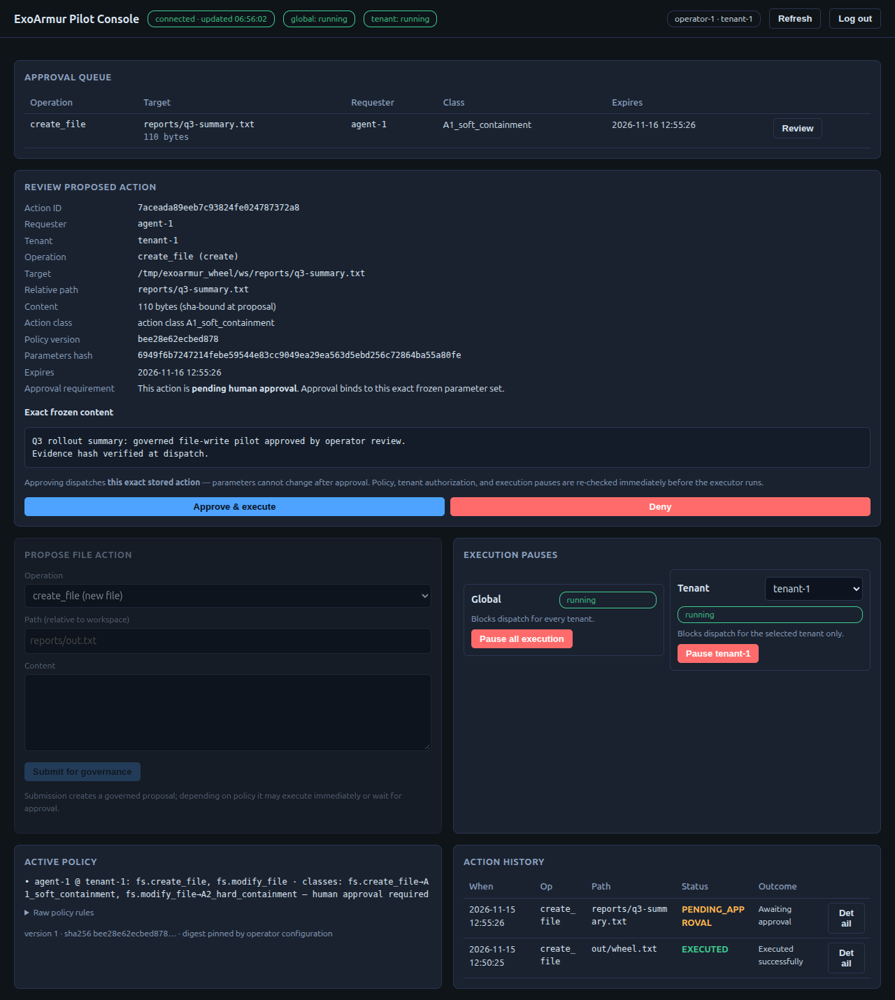
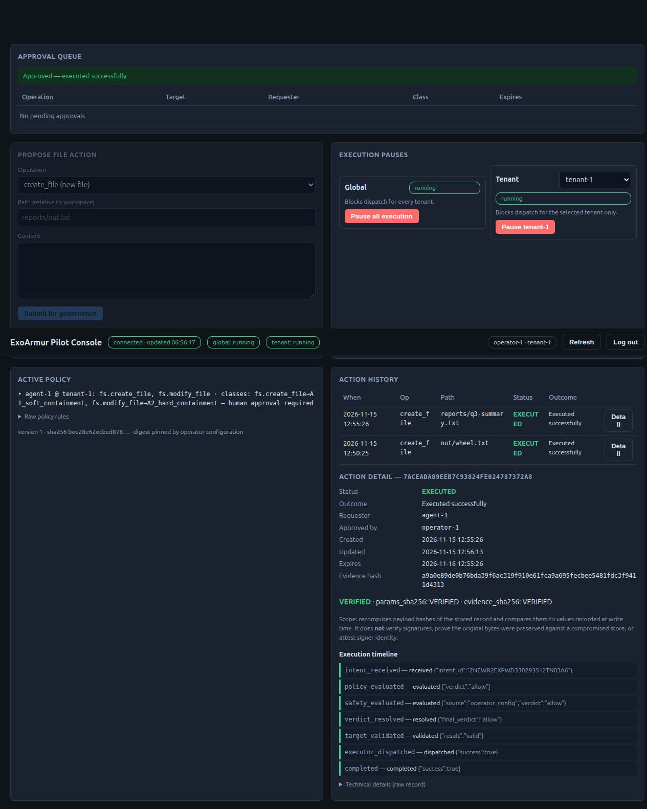

# ExoArmur Core

**Review and authorize agent file writes before they execute.**

ExoArmur provides a self-hosted workflow for authenticated action proposals, exact-content human approval, execution pauses, and recorded decision evidence. The supported pilot is a bounded filesystem workflow: an agent proposes a file create/modify, an authenticated operator reviews the exact frozen content, and only an approved action is dispatched to a real executor inside a confined workspace.

## Quickstart: run the pilot

The pilot requires a source checkout (the PyPI release `exoarmur-core 2.1.0` predates the pilot — see [Installation](#installation) for details):

```bash
git clone https://github.com/slucerodev/ExoArmur-Core
cd ExoArmur-Core
python -m venv .venv && source .venv/bin/activate
pip install -e ".[postgres,demo-api]"   # runtime deps for the pilot server
```

Then follow the full runbook — create a PostgreSQL database, bootstrap the agent and approver principals, and start the server:

**[docs/PILOT.md — Pilot Runbook](docs/PILOT.md)**

The supported server is `exoarmur.api.server:create_pilot_app`, which exposes `/health` and `/api/pilot/*` only (FastAPI's `/docs`, `/redoc`, `/openapi.json` schema endpoints are also enabled). The operator console is at `/api/pilot/gui`.

**Operator console (real screenshots from a local pilot instance):**

*Approval review — the operator sees the exact frozen content, requester, target, expiry, and approval requirement before "Approve & execute" dispatches immediately:*



*Executed outcome — status, verification verdict (hash consistency, not signer verification), and the full execution timeline:*



## What ExoArmur Is

A deterministic governance runtime that sits between an AI decision layer and execution targets. Every action that reaches the `ProxyPipeline` boundary passes through policy evaluation, a safety gate, target validation, and executor dispatch, with an execution trace recorded along the way.

**Scope:** ExoArmur governs only actions that are routed through its boundary. An agent must be integrated to submit governed actions — ExoArmur does not automatically intercept or control an agent's other filesystem or network access.

## What ExoArmur Is Not

- **Not** a full autonomous system — it is a governance layer, not an agent
- **Not** a platform executor — Core does not include vendor SDK integrations (LangChain, OpenAI, Anthropic, HuggingFace are scaffolds only; real vendor calls live in optional addon packages)
- **Not production-certified** — this is a reference implementation seeking formal verification
- **Not** externally audited — security and compliance are self-validated, not third-party audited
- **Not a complete governed service out of the box** — the kernel is importable as a pure Python library, and the repository also ships an optional FastAPI API/demo layer (`exoarmur.api` `create_app`) that is **not authenticated** and only partially governed (see [Known Limitations](docs/KNOWN_LIMITATIONS.md))

## Installation

### Supported pilot (source install — recommended)

```bash
git clone https://github.com/slucerodev/ExoArmur-Core
cd ExoArmur-Core
python -m venv .venv && source .venv/bin/activate
pip install -e ".[postgres,demo-api]"
```

Requires Python 3.10+ and a reachable PostgreSQL 12+ database for the pilot. Operator installation uses the `postgres` and `demo-api` extras; the `dev` extra is only needed to run the test suite (`pip install -e ".[dev]"`).

> **PyPI note:** `pip install exoarmur-core` currently installs version **2.1.0**, which predates the pilot and does not contain `create_pilot_app`. Until a newer release is published, install from source as above. Do not treat the PyPI package as the pilot.

### Legacy/demo API surface (unauthenticated)

The `exoarmur.api` `create_app` factory mounts legacy demo routers (`/v1/*`, `/api/v2/*`, `/api/cli/*`) that are **not authenticated** and not part of the supported pilot. It exists for deterministic demos and CLI bridging only:

```bash
pip install -e ".[demo-api]"
uvicorn exoarmur.api.server:create_app --factory
```

Do not deploy `create_app` as a governed service — see [Known Limitations](docs/KNOWN_LIMITATIONS.md).

## Quickstart (library)

For library/kernel use without the pilot server:

```bash
pip install -e .
python -c "import exoarmur; print(exoarmur.__version__)"
```

The `exoarmur` CLI currently exposes `version` and `info` commands:

```bash
exoarmur --help
exoarmur version
```

## CLI Usage

```bash
Usage: exoarmur [OPTIONS] COMMAND [ARGS]...

  ExoArmur Core – deterministic governance and replayable audit layer for execution.

Options:
  --version  Show the version and exit.
  --help     Show this message and exit.

Commands:
  info      Show ExoArmur Core information.
  version   Show ExoArmur Core version information.
```

## Current Validation Status

**Test Suite (last recorded full run, November 15, 2026, local):** 398 passed, 17 skipped, 0 failed. GitHub Actions could not run for the pilot merge due to a billing restriction; these are recorded local results, not CI output. Pilot integration tests: `tests/api/test_pilot.py` — 24 passed against real PostgreSQL. Earlier dated run: 338 passed / 17 skipped (May 31, 2026).

```bash
python -m pytest tests/ -q -rs
```

**E2E Tests (dated run):** 22 passed, 0 failed

```bash
python -m pytest tests/e2e/ -v
```

See [PROJECT_STATUS.md](PROJECT_STATUS.md) and [docs/VALIDATION_MATRIX.md](docs/VALIDATION_MATRIX.md) for detailed, dated validation status.

## Executors

**Core Executors (included in exoarmur-core):**
- **FileSystemExecutor** — governs file operations (create, delete, rename, modify) with rollback plans and state-hash verification against the local filesystem
- **DatabaseExecutor** — governs SQLite operations with transaction rollback and state verification

**Platform Executor Scaffolds (reference implementations only — no live vendor calls):**
- **openai_executor.py** — Scaffold returning mock data; `_execute_openai_operation()` does not call the OpenAI API
- **anthropic_executor.py** — Scaffold for Anthropic API governance
- **huggingface_executor.py** — Scaffold for HuggingFace model governance
- **langchain_executor.py** — Scaffold for LangChain agent governance

**Note:** A class existing does not establish a functioning vendor integration. Real platform integrations (with actual API calls) belong in optional addon packages (e.g., `exoarmur-openai-executor`). Core provides the plugin infrastructure and evidence schema for external effects, but does not include vendor SDK integrations. The `POST /api/cli/ai-complete` endpoint uses the external `exoarmur-openai-executor` package in **REPLAY (mocked) mode only** — it does not perform live OpenAI calls.

## Demo Artifacts

ExoArmur includes demo artifacts in `examples/demo_artifacts/` that are safe public sample data generated from real Core E2E flows. These artifacts are intended for future Web UI/demo use and require no vendor SDKs, network calls, secrets, or machine-specific paths.

See [examples/demo_artifacts/README.md](examples/demo_artifacts/README.md) for details.

## Determinism

The kernel enforces deterministic replay through:
- Canonical JSON (sorted keys, no whitespace variation)
- Controlled clock abstraction (deterministic time for replay, wall-clock for coordination)
- Zero randomness in the decision path
- Zero ML in the authority path

## DACT Compliance

DACT (Deterministic Autonomy Compliance Test) v0.2 is **ExoArmur's own evaluation framework**, defined in [docs/DACT_STANDARD_v0.2.md](docs/DACT_STANDARD_v0.2.md) — it is not an independent standard or certification body.

| Level | Requirement | Status |
|-------|-------------|--------|
| 1 | Deterministic Replay | ✅ Internally evaluated by the test suite |
| 2 | Cryptographic Attestation | ⚠️ Partially — canonical hashes over evidence; signatures stored but **not** verified (`NOT_CHECKED`) |
| 3 | Counterfactual Analysis | ❌ Not implemented — no counterfactual engine exists on this baseline |
| 4 | ML Isolation | ✅ Internally evaluated |
| 5 | Air-Gap Integrity | ✅ Internally evaluated (kernel scope) |
| 6 | Formal Verification | ⏳ Pending external/formal review |

**Note:** DACT is ExoArmur's own framework — Levels 1, 4, 5 are internally evaluated by dedicated compliance tests; Level 2 is partial (hash consistency only, no signature verification); Level 3 is not implemented. This is self-assessment, not certification. Level 6 remains pending.

**Honest scope of "replay verification":** the replay endpoints recompute canonical hashes from stored records and compare them. Recomputing a hash from stored content alone does not prove the original content was preserved — it detects inconsistencies between stored fields, not tampering that rewrote both content and hash. Separately, `kernel/replay_verification.py` compares stored request/response hashes against canonical recomputation (`VERIFIED`/`MISMATCH`/`MALFORMED`/`NOT_CHECKED`), and evidence signatures are explicitly reported as `NOT_CHECKED` because signature verification is not implemented.

## Architecture

The kernel consists of:

| Module | Purpose |
|--------|---------|
| `kernel/boundary.py` | Minimal routing: Intent → Policy → Safety → Executor → Audit |
| `kernel/clock.py` | Clock abstraction with utc_now and DeterministicClock |
| `kernel/ids.py` | Deterministic ULID generation for governance entities |
| `kernel/trust_evaluator.py` | Formal interface (raises NotImplementedError) |
| `kernel/external_effect.py` | External effect evidence and replay verification |
| `kernel/replay_verification.py` | Replay verification engine |
| `kernel/plugin_registry.py` | Plugin discovery and registration |
| `kernel/canonicalization.py` | Canonical JSON encoding |
| `executors/file_system_executor.py` | FileSystemExecutor with governance integration |
| `executors/database_executor.py` | DatabaseExecutor with transaction rollback |
| `executors/langchain_executor.py` | LangChainExecutor scaffold (reference implementation) |
| `executors/openai_executor.py` | OpenAIExecutor scaffold (reference implementation) |
| `executors/anthropic_executor.py` | AnthropicExecutor scaffold (reference implementation) |
| `executors/huggingface_executor.py` | HuggingFaceExecutor scaffold (reference implementation) |

**Total kernel: ~1,800 lines** (the `kernel/` package alone; executors and the API layer are additional)

## Status

Reference implementation (source version 2.2.0; the published PyPI release is older — see [Installation](#installation)). Single maintainer. Apache-2.0 licensed, public repository. Not production-certified. Not externally audited. The deterministic kernel and replay verification are internally evaluated. The supported pilot surface (`create_pilot_app`: authenticated, policy-controlled file-write workflow with approvals, durable pauses, evidence, and an operator GUI) is on `main` — see [docs/PILOT.md](docs/PILOT.md). The legacy HTTP demo layer (`create_app`) is **not authenticated** — see [Known Limitations](docs/KNOWN_LIMITATIONS.md). GitHub Actions could not run for the pilot merge due to a billing restriction; validation relied on recorded local tests and live demonstrations. Seeking formal verification partnership and pilot integrations.

## Documentation

- [Documentation Index](docs/README.md) — Table of contents for all documentation
- [The ExoArmur Doctrine](docs/DOCTRINE.md) — Design doctrine and claims, with an explicit verification-status section separating goals from what is implemented
- [Architecture](docs/ARCHITECTURE.md) — System architecture
- [ML Isolation Policy](docs/ML_ISOLATION.md) — Advisory-only ML components
- [DACT Standard v0.2](docs/DACT_STANDARD_v0.2.md) — Deterministic Autonomy Compliance Test specification
- [Formal Verification Invariants](docs/formal_verification/INVARIANTS.md) — Formal specifications for DACT Level 6
- [LangChain Executor Integration](docs/integrations/LANGCHAIN_EXECUTOR.md) — Scaffold integration guide
- [Project Status](PROJECT_STATUS.md) — Current validation status and roadmap
- [Known Limitations](docs/KNOWN_LIMITATIONS.md) — Disclosed gaps, including unauthenticated API and incomplete governance wiring
- [Validation Matrix](docs/VALIDATION_MATRIX.md) — Dated test/security validation results
- [Security Policy](SECURITY.md) — Security policy and threat model
- [Contributing](CONTRIBUTING.md) — Contribution policy and development setup
- [Changelog](CHANGELOG.md) — Version history

## License

Apache 2.0 — see [LICENSE](LICENSE) for full terms.

ExoArmur Core is free, open-source software. You may use, modify, and distribute it under the terms of the Apache License 2.0. Commercial support, hosted offerings, and proprietary module integrations are not covered by this license and require separate agreement.

## Contributing

We welcome contributions — bug reports, architecture feedback, porting efforts, and formal verification collaboration. See [CONTRIBUTING.md](CONTRIBUTING.md) for setup, guidelines, and safety rules.

Please open an issue before proposing large changes so we can align on design.
